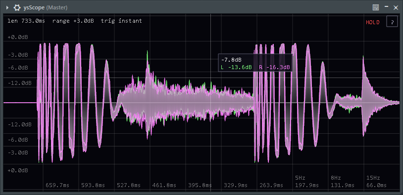

# lzScope — CLAP oscilloscope for Windows and macOS

A stereo oscilloscope [CLAP](https://cleveraudio.org/) plugin written entirely
in Free Pascal / Lazarus, with an OpenGL GUI inspired by the Cockos "Oscilloscope Meter" JSFX.

## Features

- Stereo waveform display — left and right channels overlaid
- Time zoom from 1 ms to 5 s (mouse wheel) and vertical zoom from -60 to +36 dB
  (ctrl+wheel, cmd+wheel on macOS), with adaptive dB and time/frequency grids
- Four trigger modes: instant, any, ascending, descending (right-click or
  control-click to cycle)
- Hold mode: click to freeze the exact view on screen, drag to scrub back through
  the history, wheel-zoom around the cursor while frozen
- Crosshair readout: level under the cursor plus per-channel peak dB at that point
- Lightweight and GPU-accelerated

## Building

Free Pascal 3.2.2 (with Lazarus, or just `fpc`). Each script builds the
plugin and the test host, runs the tests and installs the plugin only if
they pass.

- **Windows**: `build.ps1` installs `lzscope.clap` into
  `%LOCALAPPDATA%\Programs\Common\CLAP`
- **macOS** (Apple Silicon): `brew install fpc`, then `./build.sh` installs
  `lzScope.clap` into `~/Library/Audio/Plug-Ins/CLAP`. The bundle is signed
  ad hoc: it loads on the Mac that built it; other Macs need a Developer ID
  signature

`tests/testhost -i` opens the editor in a window with a test signal.

## Layout

The DSP, the CLAP glue and the editor are portable. Everything that touches
the OS is behind `src/gui/scope_gui_os.pas`, implemented once per platform:

- `src/gui/os/scope_os_win32.inc`: child window, WGL, GDI text
- `src/gui/os/scope_os_cocoa.inc`: NSView, NSOpenGLContext driven through
  CGL from the render thread, CoreText

`scope_gui_input.pas` turns mouse events from either into editor actions.
